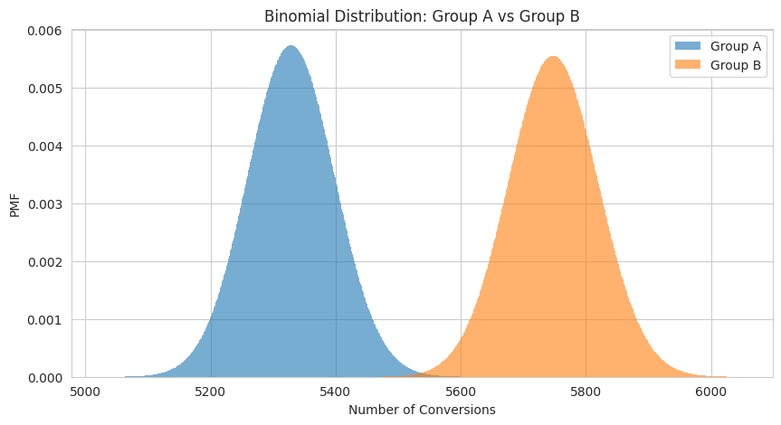
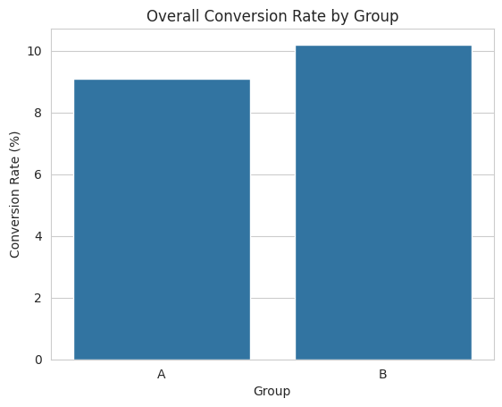
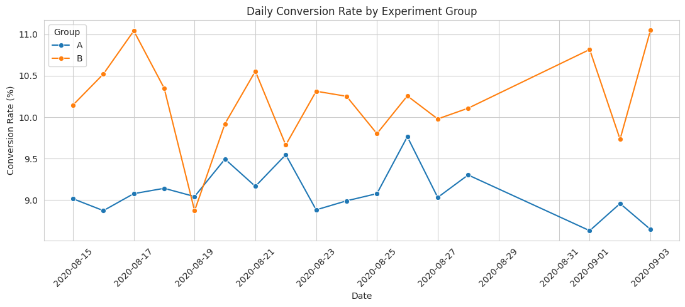

# A/B Testing: Conversion Rate Analysis & Experiment Validation

## The Decision

**Should the business launch Group B to increase conversions and improve customer acquisition?**

An A/B test compared two versions, **Group A (Control)** and **Group B (Treatment)**, to determine whether the new version improved conversion rates.

Group B achieved a higher conversion rate of **10.20%**, compared with **9.10%** for Group A, representing approximately **12% more conversions for the same number of visitors**.

However, the experiment also showed a statistically significant **Sample Ratio Mismatch (SRM)**, raising concerns about whether users were assigned to the two groups as expected.

**Recommendation:** Do not launch Group B yet. Although it shows a statistically significant improvement in conversions, the SRM warning must be investigated before the results can be trusted.

## What the Business Needs to Know

| Metric | Result |
|---|---|
| Total Users | 114,933 |
| Group A Conversion Rate | 9.10% |
| Group B Conversion Rate | 10.20% |
| Absolute Improvement | +1.10 percentage points |
| Relative Lift | +12.14% |
| Statistical Significance | p-value = 2.293e-10 |

**Key Findings:**

- **Group B outperformed Group A**, generating approximately 12% more conversions for the same number of visitors.
- The difference is **statistically significant**, with a 95% confidence interval indicating an improvement of **0.76 to 1.45 percentage points**.
- Group B generally maintained higher daily conversion rates throughout the experiment.
- The SRM test detected an unexpected difference in group allocation (**50.97% Group A vs. 49.03% Group B**), which should be investigated before making a launch decision.

The binomial distributions illustrate the expected number of conversions for each group based on their observed conversion rates.  
Group B's distribution is shifted to the right, indicating higher expected conversions. 

## Recommended Actions

### 1. Investigate the Sample Ratio Mismatch (SRM) before launching

The experiment was expected to allocate users equally between Groups A and B. However, the SRM test returned a p-value of **4.498e-11**, indicating a statistically significant deviation from the expected 50/50 split.

This could indicate problems with user assignment, data collection, or experiment execution.

**Recommended action:** Review the randomization process, user eligibility rules, and tracking systems to identify the cause of the mismatch. If the issue could bias the results, correct it and rerun the experiment before making a launch decision.

**Measure success:** Confirm that the experiment passes SRM checks and produces reliable conversion data.

### 2. Evaluate Group B's potential impact on customer acquisition

Group B achieved a **10.20% conversion rate**, compared with **9.10%** for Group A.

This represents a **1.10 percentage-point improvement**, or approximately **12% more conversions** for the same number of visitors.

The statistical test suggests that this difference is unlikely to be explained by random variation alone, assuming the experiment is valid.

**Recommended action:** If the SRM issue is resolved and the results remain reliable, consider a controlled rollout of Group B to evaluate whether the improvement continues under normal business conditions.

**Measure success:** Monitor conversion rates, incremental conversions, and customer acquisition performance after rollout.

### 3. Evaluate business performance beyond conversion rates

A higher conversion rate does not automatically guarantee higher revenue or profitability.

For example, Group B might generate more conversions while also increasing refunds or attracting customers who spend less.

**Recommended action:** Compare revenue per customer, average order value, refund rates, and profitability between the two groups before expanding Group B.

**Measure success:** Confirm that higher conversions translate into improved revenue and profitability without negatively affecting other important business metrics.

### 4. Review conversion performance across weekdays and weekends

Group B generally achieved higher daily conversion rates, although performance fluctuated throughout the experiment.

These fluctuations make it important to consider whether user behavior differs between weekdays and weekends.

**Recommended action:** Compare weekday and weekend conversion rates and confirm that the experiment covers a representative mix of user activity.

**Measure success:** Verify that Group B's improvement remains reasonably consistent across time periods and is not driven primarily by a particular day or unusual traffic pattern.

## How I Built It

**Tools:** Python, Pandas, SciPy, Statsmodels, Matplotlib, Seaborn, Google Colab

- **Data preparation:** Loaded and examined 114,933 user-level records, checking for missing values, duplicate users, valid group assignments, and conversion indicators.
- **Experiment validation:** Used a chi-square goodness-of-fit test to detect Sample Ratio Mismatch against the expected 50/50 allocation.
- **Exploratory analysis:** Calculated user counts, total conversions, conversion rates, and daily conversion trends for both groups.
- **Statistical testing:** Applied a two-proportion z-test using `proportions_ztest()` to determine whether the conversion-rate difference was statistically significant.
- **Effect estimation:** Calculated absolute improvement, relative lift, and a 95% confidence interval using `confint_proportions_2indep()`.
- **Data visualization:** Created bar charts and a daily conversion-rate line chart to communicate the results.
- **Business recommendations:** Translated statistical findings into actionable recommendations while considering experiment validity and potential business risks.

Data Source: Obtained from [DataCamp's DataLab](https://www.datacamp.com/datalab/templates/recipe-python-analyze-ab-test-results?utm_source=chatgpt.com).
